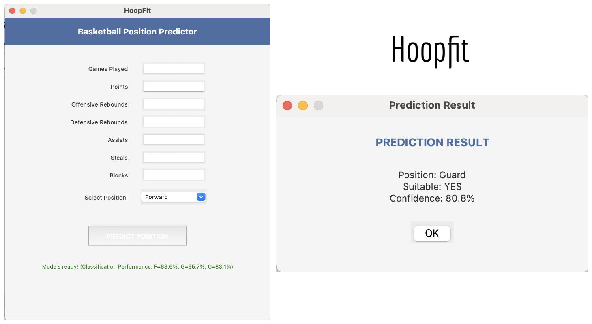

# HoopFit

A desktop app that uses machine learning to predict which basketball position (guard, forward, or center) fits a player best, based on their season stats.



## Why
I wanted to see whether a player's performance stats could tell an objective story about their role on the court: does this player *play* like a guard, a forward, or a center?

## Data
Season stats for 444 high school basketball players, using seven features:

| Feature | Meaning |
|---|---|
| GP | Games played |
| Pts | Points |
| OReb | Offensive rebounds |
| DReb | Defensive rebounds |
| Ast | Assists |
| Stl | Steals |
| Blk | Blocks |

Many players are listed at more than one position, so instead of one multi class model I trained a separate yes/no classifier for each position (forward, guard, center).

## Models
For each position I compared six classifiers, tuning each with `GridSearchCV`:

- Logistic regression
- Decision tree
- Random forest
- K nearest neighbors
- XGBoost
- Support vector machine

Test accuracy of the best model for each position:

| Position | Best model | Test accuracy |
|---|---|---|
| Forward | Logistic regression | 0.83 |
| Guard | Logistic regression | 0.90 |
| Center | K nearest neighbors | 0.92 |

Tree based models (random forest, XGBoost, decision tree) tended to overfit on this small dataset, scoring much higher on training data than on test data, so simpler models generalized better. Centers were the hardest case because they make up only 39 of the 444 players.

In the app, the final models reach ROC AUC scores of 88.6% (forward), 95.7% (guard), and 83.1% (center) on held out data.

## The app
HoopFit is a Tkinter desktop app. Enter a player's stats and pick a position, and it tells you whether the player fits that position along with the model's confidence. I also packaged it into a standalone executable with PyInstaller so it runs without installing Python.

## Files
```
HoopFit.py                 Desktop app (Tkinter)
trainmodel.py              Training and evaluation script
model_comparison.ipynb     Notebook comparing all six models with grid search
data.csv                   Anonymized player stats
requirements.txt           Python dependencies
```

## Run it
```
pip install -r requirements.txt
python HoopFit.py
```

## Future work
- Collect more data, especially for centers, to fix the class imbalance
- Add per game and efficiency features like shooting percentages
- Recommend the single best position directly instead of checking one at a time
